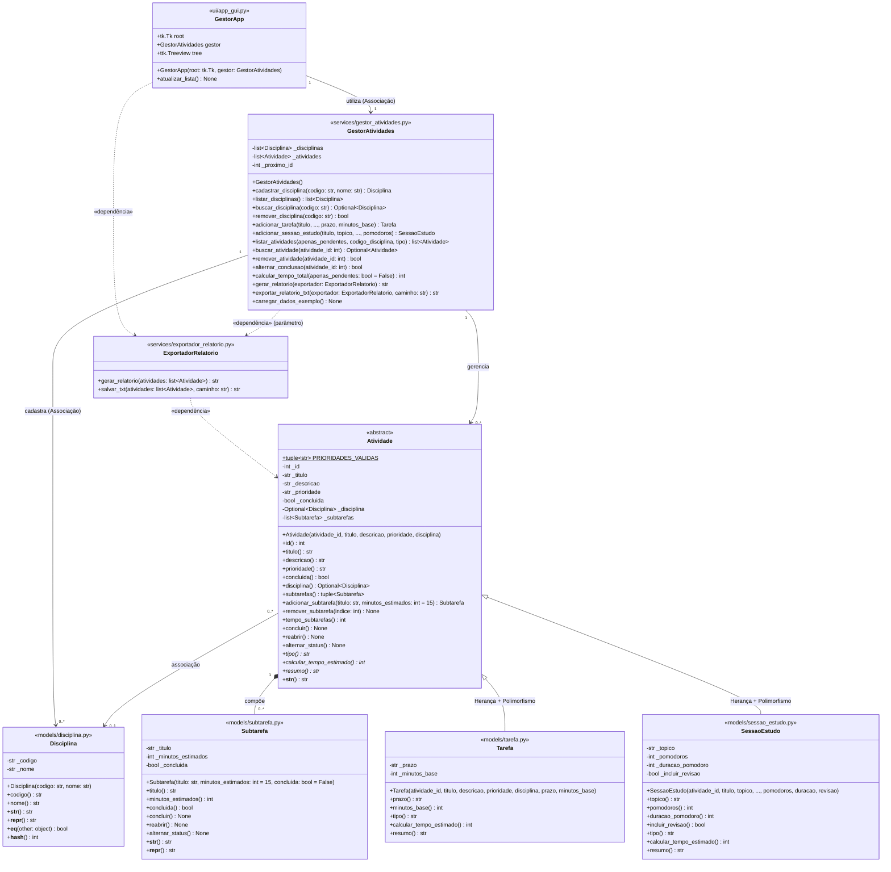

# Gestão de Tarefas e Estudo (POO em Python)

Aplicação desktop em Python puro (apenas biblioteca padrão + `tkinter`/`ttk`) desenvolvida para demonstrar na prática os fundamentos e relacionamentos da **Programação Orientada a Objetos (POO)**: **Herança**, **Polimorfismo**, **Composição**, **Associação**, **Dependência**, **Abstração** e **Encapsulamento**.

---

## Principais Funcionalidades

- Cadastro e remoção de **Disciplinas** (com normalização automática de código e prevenção de duplicidade).
- Criação e gerenciamento polimórfico de **Tarefas** (com prazo e tempo base) e **Sessões de Estudo** (baseadas em técnica Pomodoro e revisão opcional).
- Gerenciamento de **Subtarefas** compostas dentro de cada atividade, somando automaticamente ao tempo estimado.
- Filtros dinâmicos por **Disciplina**, **Tipo de Atividade** e **Status (Apenas pendentes)**, com métricas em tempo real.
- Geração e exportação de **Relatórios em `.txt`** (UTF-8) usando um exportador desacoplado por dependência.
- Carga inicial de **dados de exemplo** para demonstração imediata.

---

## Estrutura de Pastas

```text
Gestor-de-Tarefas-e-Estudo/
├── main.py                         # Ponto de entrada da aplicação desktop
├── README.md                       # Visão geral, comandos e roteiro de vídeo
├── LICENSE                         # Licença CC0 1.0 Universal
├── docs/
│   └── uml.md                      # Diagrama UML detalhado e tabela de conceitos POO
├── models/
│   ├── __init__.py
│   ├── disciplina.py               # Classe Disciplina (Associação)
│   ├── subtarefa.py                # Classe Subtarefa (Composição)
│   ├── atividade.py                # Classe abstrata Atividade (ABC, encapsulamento e composição)
│   ├── tarefa.py                   # Subclasse Tarefa (Herança e Polimorfismo)
│   └── sessao_estudo.py            # Subclasse SessaoEstudo (Herança e Polimorfismo)
├── services/
│   ├── __init__.py
│   ├── exportador_relatorio.py     # Serviço sem estado ExportadorRelatorio (Dependência)
│   └── gestor_atividades.py        # Orquestração de domínio GestorAtividades
├── ui/
│   ├── __init__.py
│   └── app_gui.py                  # Interface gráfica Tkinter/ttk (GestorApp)
└── tests/
    ├── __init__.py
    └── test_gestor.py              # Suíte unittest cobrindo POO, regras e smoke test da GUI
```

---

## Diagrama de Classes UML



Para a legenda completa dos pilares POO e da arquitetura em camadas, consulte [docs/uml.md](docs/uml.md).

---

## Como Executar

> Pré-requisito: **Python 3.11+** (testado em Python 3.15, usando somente a biblioteca padrão).

### 1. Executar a aplicação desktop (`Tkinter`)

```bash
python main.py
```

### 2. Executar a suíte de testes automatizados (`unittest`)

```bash
python -m unittest discover -s tests -v
```

---

## Roteiro de Vídeo (YouTube — até 3 minutos)

Use este roteiro enxuto para apresentar o funcionamento do aplicativo, a modelagem UML e os testes dentro de **2 min 45 s a 3 min**:

| Tempo | Bloco | O que mostrar e falar |
| :--- | :--- | :--- |
| **0:00 – 0:25** | **Abertura e Objetivo** | Mostre o título e a estrutura de pastas (`models`, `services`, `ui`, `tests`, `docs`). Explique que o projeto é um **Gestor de Tarefas e Estudos** feito em Python puro com `Tkinter` para demonstrar os 5 pilares/relações de POO. |
| **0:25 – 1:15** | **Demonstração do App (`python main.py`)** | Rode `python main.py`. Mostre os dados iniciais carregados, crie uma **Nova Tarefa** ou **Sessão de Estudo** (Pomodoro + revisão), abra **Subtarefas** para adicionar/concluir itens e mostrar o recálculo imediato de tempo. Aplique filtros (Disciplina, Tipo, Apenas pendentes) e abra **Relatório** para visualizar e salvar em `.txt`. |
| **1:15 – 2:20** | **Arquitetura POO e UML (`docs/uml.md`)** | Exiba o diagrama Mermaid no `README.md` / `docs/uml.md` e faça um tour rápido pelo código: **(1) Herança & Polimorfismo** (`Atividade` abstrata -> `Tarefa` e `SessaoEstudo` sobrescrevendo `calcular_tempo_estimado()` e `resumo()`); **(2) Composição** (`Atividade` cria e destrói `Subtarefa`); **(3) Associação** (remover `Disciplina` preserva atividades com `disciplina = None`); **(4) Dependência** (`GestorAtividades` recebe `ExportadorRelatorio` apenas por parâmetro). |
| **2:20 – 2:55** | **Testes Automatizados e Encerramento** | Rode `python -m unittest discover -s tests -v` no terminal mostrando todos os testes passando (incluindo herança, polimorfismo, composição, associação, dependência e smoke test da GUI). Finalize destacando que a separação em camadas mantém a lógica de negócio 100% independente da interface gráfica. |
