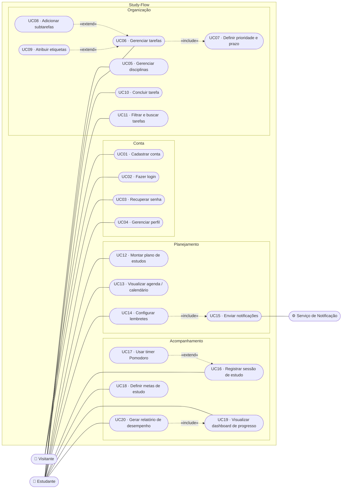

# Study-Flow — Diagrama de Casos de Uso

> **Nível 1** — Funcionalidades do sistema e como os atores interagem com elas.

O Mermaid não tem um tipo nativo para diagramas de caso de uso. Por isso, ele foi montado com `flowchart`: os atores ficam fora do retângulo do sistema e os casos de uso aparecem como elipses dentro dele.

> **Observação:** com exceção de **UC01**, **UC02** e **UC03**, todos os casos de uso exigem que o usuário esteja autenticado (pré-condição: *UC02 · Fazer login*). Essa ligação foi omitida do diagrama para não poluir a leitura.

## Atores

| Ator | Tipo | Descrição |
|---|---|---|
| **Visitante** | Primário | Pessoa ainda não autenticada que pode criar conta, entrar ou recuperar a senha. |
| **Estudante** | Primário | Usuário autenticado que organiza tarefas, planeja e acompanha os estudos. |
| **Serviço de Notificação** | Secundário (sistema) | Serviço externo/agendador que entrega lembretes (e-mail, push, etc.). |

## Descrição dos casos de uso

| ID | Caso de uso | Descrição resumida |
|---|---|---|
| UC01 | Cadastrar conta | Criar conta com nome, e-mail e senha. |
| UC02 | Fazer login | Autenticar-se com e-mail e senha. |
| UC03 | Recuperar senha | Redefinir a senha via link enviado por e-mail. |
| UC04 | Gerenciar perfil | Editar dados pessoais e alterar a senha. |
| UC05 | Gerenciar disciplinas | Criar, editar, listar e excluir disciplinas. |
| UC06 | Gerenciar tarefas | Criar, editar, listar e excluir tarefas, ligadas ou não a uma disciplina. |
| UC07 | Definir prioridade e prazo | Informar a data de entrega e o nível de prioridade da tarefa (obrigatório ao criar). |
| UC08 | Adicionar subtarefas | Quebrar uma tarefa em itens de checklist (opcional). |
| UC09 | Atribuir etiquetas | Classificar a tarefa com etiquetas personalizadas (opcional). |
| UC10 | Concluir tarefa | Marcar a tarefa como concluída e registrar a data de conclusão. |
| UC11 | Filtrar e buscar tarefas | Filtrar por status, prioridade, disciplina, etiqueta ou prazo. |
| UC12 | Montar plano de estudos | Montar um cronograma semanal com blocos de horário por disciplina. |
| UC13 | Visualizar agenda / calendário | Ver tarefas e blocos de estudo em visão diária, semanal ou mensal. |
| UC14 | Configurar lembretes | Agendar avisos antes do prazo de uma tarefa. |
| UC15 | Enviar notificações | O sistema dispara o lembrete na data/hora configurada. |
| UC16 | Registrar sessão de estudo | Marcar o tempo de estudo de uma disciplina ou tarefa. |
| UC17 | Usar timer Pomodoro | Registrar a sessão com ciclos de foco e pausa (opcional). |
| UC18 | Definir metas de estudo | Definir uma meta de tempo diária, semanal ou mensal. |
| UC19 | Visualizar dashboard de progresso | Ver horas estudadas, tarefas pendentes/concluídas e andamento das metas. |
| UC20 | Gerar relatório de desempenho | Gerar e exportar um relatório consolidado de um período. |

## Legenda

| Notação | Significado |
|---|---|
| Linha contínua (`---`) | Associação entre ator e caso de uso. |
| `«include»` | O caso de uso base **sempre** executa o caso incluído. |
| `«extend»` | O caso de uso estendido é **opcional** e acrescenta comportamento ao caso base. |
