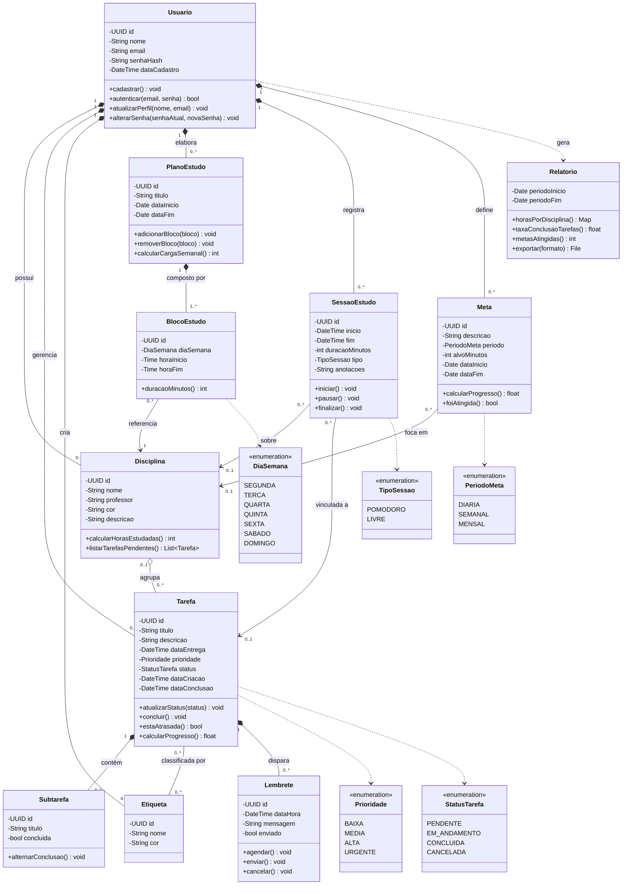

# Study-Flow — Diagrama de Classes (UML)

> **Nível 1** — Modelagem do domínio da aplicação.

O diagrama abaixo representa as principais entidades do Study-Flow, seus atributos, métodos e relacionamentos.

## Descrição das classes

| Classe | Responsabilidade |
|---|---|
| **Usuario** | Estudante que utiliza a plataforma; dono de todos os dados. |
| **Disciplina** | Matéria/assunto de estudo (ex.: Cálculo I, Inglês). Agrupa tarefas e sessões. |
| **Tarefa** | Atividade com prazo e prioridade (trabalho, prova, exercício, leitura). |
| **Subtarefa** | Item de checklist dentro de uma tarefa, usado para medir o progresso. |
| **Etiqueta** | Marcador livre para classificar e filtrar tarefas. |
| **PlanoEstudo** | Cronograma de estudos válido por um período. |
| **BlocoEstudo** | Horário fixo do cronograma (dia da semana + intervalo) ligado a uma disciplina. |
| **SessaoEstudo** | Registro de tempo efetivamente estudado (livre ou Pomodoro). |
| **Meta** | Objetivo de tempo de estudo por período (diária, semanal, mensal). |
| **Lembrete** | Notificação agendada relacionada a uma tarefa. |
| **Relatorio** | Consolida dados de sessões, tarefas e metas para acompanhamento do desempenho. |

## Legenda dos relacionamentos

| Símbolo | Significado |
|---|---|
| `*--` | **Composição** — a parte não existe sem o todo (ex.: Subtarefa sem Tarefa). |
| `o--` | **Agregação** — a parte pode existir sem o todo (ex.: Tarefa sem Disciplina). |
| `-->` | **Associação direcionada** — uma classe referencia a outra. |
| `--` | **Associação** — relação entre as classes nos dois sentidos (N:N entre Tarefa e Etiqueta). |
| `..>` | **Dependência** — uma classe usa a outra (ex.: Relatório gerado sob demanda). |
