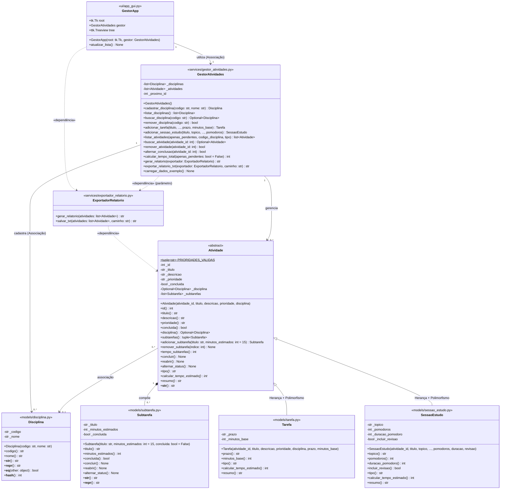

# Diagrama de Classes UML 2.5 — Study-Flow (POO em Python)

Arquitetura em camadas (`models` · `services` · `ui`) evidenciando **Herança**, **Polimorfismo**, **Composição**, **Associação** e **Dependência**.

## Diagrama de Classes (`classDiagram`)

> **Notação:** `-` indica atributo privado encapsulado (exposto via `@property`), `+` indica membro público, `$` indica atributo de classe e `*` indica método abstrato (`@abstractmethod`) sobrescrito polimorficamente pelas subclasses.

## Visão Geral da Arquitetura em Camadas

| Camada | Classes |
| :--- | :--- |
| **UI** (`ui/`) | `GestorApp` (Tkinter/ttk) — interação e atualização reativa |
| **Services** (`services/`) | `GestorAtividades` e `ExportadorRelatorio` |
| **Domínio abstrato** (`models/`) | `Atividade` (ABC) + métodos abstratos |
| **Domínio concreto** (`models/`) | `Tarefa`, `SessaoEstudo`, `Subtarefa` e `Disciplina` |

## Legenda dos 5 Pilares e Relações POO

| Conceito | Notação | Aplicação no sistema |
| :--- | :---: | :--- |
| **Herança** | `<\|--` | `Tarefa` e `SessaoEstudo` estendem `Atividade` (ABC). |
| **Polimorfismo** | `*` (abstract) | `tipo()`, `calcular_tempo_estimado()` e `resumo()` são sobrescritos pelas subclasses. |
| **Composição** | `*--` | `Subtarefa` pertence à `Atividade` e morre com ela. |
| **Associação** | `-->` | `Atividade` e `Disciplina` possuem ciclos de vida independentes. |
| **Dependência** | `..>` | `ExportadorRelatorio` é usado apenas via parâmetro. |
